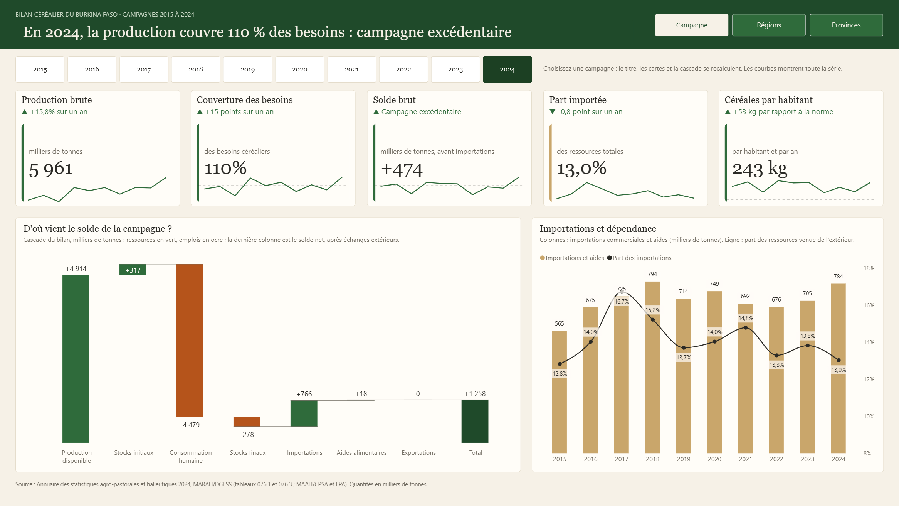
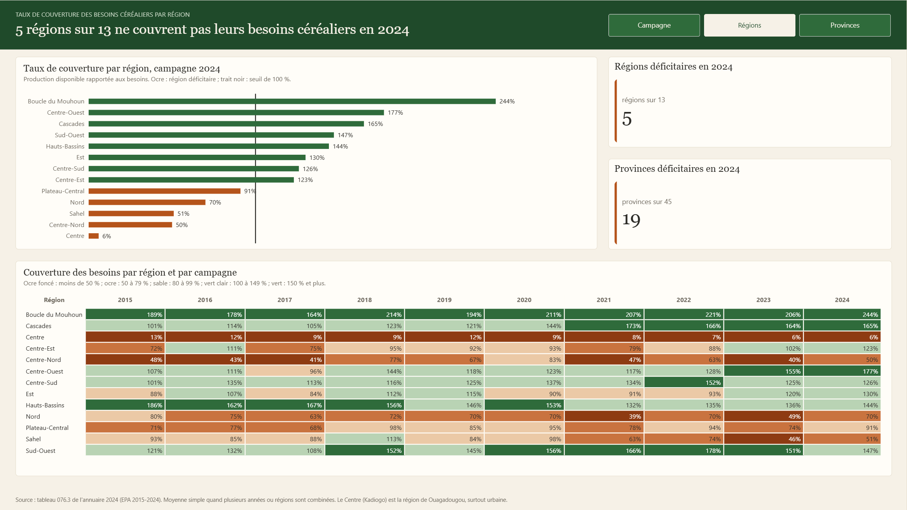
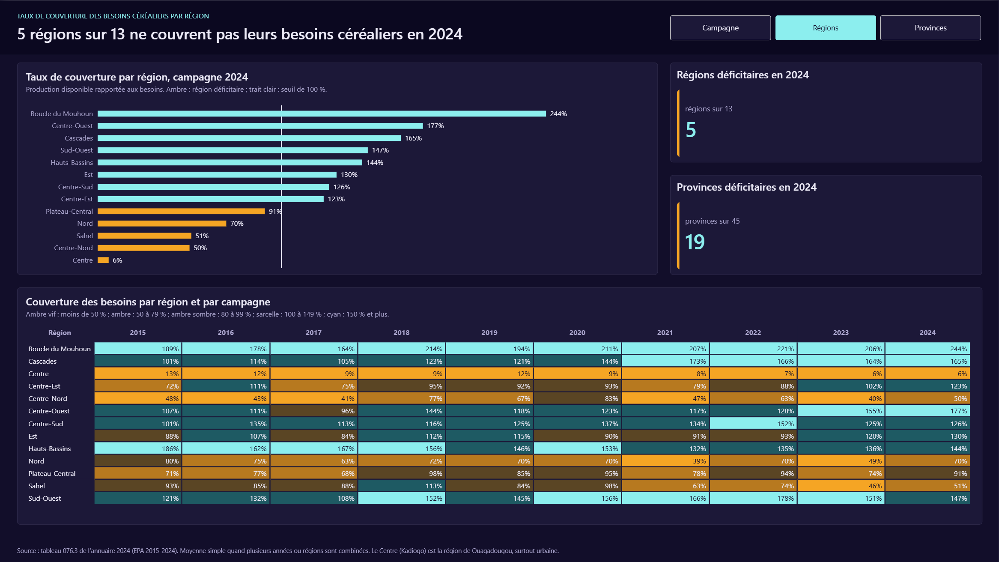
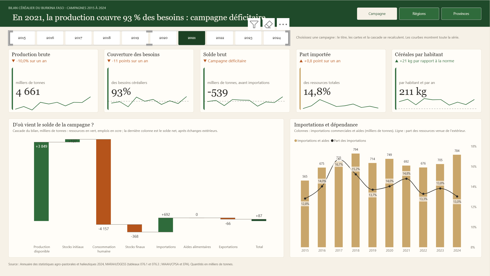
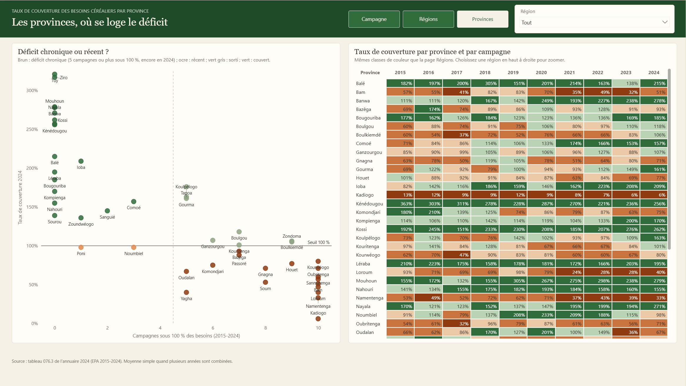
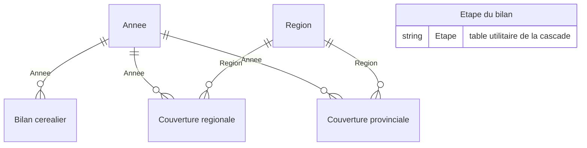

# Bilan céréalier du Burkina Faso 2015-2024 : tableau de bord Power BI

> **In short (EN).** Power BI report on Burkina Faso's cereal balance (2015-2024), built from the official
> 2024 Agro-pastoral Statistical Yearbook (MARAH/DGESS). Star-schema semantic model, 52 documented DAX
> measures, 3 report pages (national balance with a year selector, regions, provinces) delivered in two
> visual themes. Saved as a Power BI Project (PBIP), so the model (TMDL) and the report (PBIR) are readable
> as plain text in this repository.



## La question

**Le pays et ses régions produisent-ils assez de céréales pour couvrir leurs besoins, et depuis quand ?**

Le rapport répond en trois niveaux :

| Page | Question | Visuels clés |
|---|---|---|
| **Campagne** | La campagne choisie est-elle excédentaire, et d'où vient le solde ? | Sélecteur d'année, titre dynamique, 5 indicateurs avec tendance 2015-2024, cascade du bilan, importations et dépendance |
| **Régions** | Quelles régions ne couvrent pas leurs besoins, et de façon persistante ? | Classement 2024 avec seuil de 100 %, carte thermique région × année |
| **Provinces** | Le déficit d'une province est-il chronique ou récent ? | Nuage de points (campagnes sous 100 % × couverture 2024), carte thermique province × année, filtre par région |

Quelques lectures :
- **2024 est le premier excédent depuis 2020**, après trois campagnes déficitaires (2021 à 2023) : la production couvre 110 % des besoins, solde brut de +474 milliers de tonnes.
- **5 régions sur 13 restent sous 100 %** en 2024. Le Centre (Kadiogo, Ouagadougou, surtout urbain) ne couvre jamais plus de 13 % de ses besoins.
- **La dépendance aux importations reste stable**, entre 13 et 17 % des ressources céréalières.

## Deux thèmes, un même modèle

| Saison des récoltes (`pbip/`) | Salle de veille (`pbip_salle_de_veille/`) |
|---|---|
|  |  |
| Fond sable, titres serif, vert pour l'excédent, ocre pour le déficit. Pour un rapport à un ministère ou un bailleur. | Fond bleu nuit, chiffres lumineux, ambre réservé aux alertes. Pour un écran de suivi. |

Le sélecteur d'année recalcule la page Campagne (ici 2021, campagne déficitaire) :



Le nuage de points des provinces sépare les déficits chroniques (en bas à droite) des provinces toujours couvertes (à gauche) :



## Modèle sémantique

Schéma en étoile, mode Import, données lues depuis des CSV par Power Query.



| Table | Grain | Lignes |
|---|---|---|
| Bilan céréalier | une campagne | 10 |
| Couverture régionale | région × campagne | 130 |
| Couverture provinciale | province × campagne | 450 |
| Année, Région | dimensions | 10 et 13 |
| Étape du bilan | étape de la cascade (table sans relation) | 7 |

**52 mesures DAX**, toutes décrites dans le modèle : 33 mesures d'analyse et 19 mesures de mise en forme
(couleurs conditionnelles, phrases de contexte, titre dynamique). Quelques exemples :

```dax
// Évolution sur un an, quelle que soit l'année choisie
Production brute année précédente =
VAR _annee = MAX ( 'Année'[Année] )
RETURN
    CALCULATE ( [Production brute], REMOVEFILTERS ( 'Année' ), 'Année'[Année] = _annee - 1 )

// Une seule mesure alimente la cascade : ressources en positif, emplois en négatif
Montant étape du bilan =
SWITCH (
    SELECTEDVALUE ( 'Étape du bilan'[Code] ),
    "prod", [Production disponible],
    "stock_i", [Stocks initiaux],
    "conso", - [Consommation humaine],
    "stock_f", - [Stocks finaux],
    "imp", [Importations commerciales],
    "aide", [Aides alimentaires],
    "exp", - [Exportations]
)

// Nombre de campagnes sous 100 % des besoins (+ 0 pour que les provinces jamais déficitaires restent visibles)
Campagnes sous 100 % =
COUNTROWS (
    FILTER (
        VALUES ( 'Année'[Année] ),
        VAR _taux = [Taux de couverture provincial]
        RETURN NOT ISBLANK ( _taux ) && _taux < 1
    )
) + 0
```

Le code complet du modèle est dans
[`pbip/Bilan cerealier Burkina.SemanticModel/definition/tables`](pbip/Bilan%20cerealier%20Burkina.SemanticModel/definition/tables).

## Données et contrôle qualité

**Source** : *Annuaire des statistiques agro-pastorales et halieutiques 2024*, Ministère de l'Agriculture, des
Ressources animales et halieutiques, DGESS (août 2025) :
- tableau 076.1 : bilans céréaliers définitifs 2015-2024 (MAAH/CPSA) ;
- tableau 076.3 : taux de couverture des besoins céréaliers par région et par province (EPA).

Les tableaux ont été extraits du PDF par coordonnées de cellules (`scripts/extraire_bilan.py`, PyMuPDF), puis
contrôlés par les **identités comptables du bilan** sur les 10 campagnes, sans écart :
- disponibilités = production disponible + stocks initiaux ;
- besoins = consommation humaine + stocks finaux ;
- excédent brut = disponibilités − besoins ;
- excédent net = excédent brut + solde des échanges ;
- solde des échanges = importations + aides − exportations.

**Corrections documentées** : trois cellules sont illisibles ou erronées dans le PDF. Elles ont été reconstruites :
- production brute 2016 : « 9 » dans le PDF, remplacée par 4 567 (valeur du tableau 076.2) ;
- production disponible 2016 : « 24 » dans le PDF, recalculée à 3 766 par l'identité du bilan ;
- norme de consommation 2021 : « 0 » dans le PDF, remplacée par 190 kg.

Le tableau 076.2 (bilan ex-post) n'est pas utilisé : sa colonne 2019 reprend les valeurs de 2018.

## Ouvrir le rapport

1. Installer [Power BI Desktop](https://aka.ms/pbidesktopstore) (gratuit).
2. Ouvrir `pbip/Bilan cerealier Burkina.pbip` (ou `pbip_salle_de_veille/...` pour le thème sombre).
3. Dans **Transformer les données → Modifier les paramètres**, faire pointer `Dossier données` vers le dossier
   `donnees/` de ce dépôt (chemin complet, terminé par `\`).
4. Cliquer sur **Actualiser**.

## Reproduire

```bash
# 1. Extraire le bilan et la couverture depuis le PDF de l'annuaire (pip install pymupdf)
ANNUAIRE_PDF="chemin/vers/Annuaire_agro-sylvo-pastorale_2024.pdf" python scripts/extraire_bilan.py

# 2. Générer le rapport (thème, pages, visuels) puis le valider
node scripts/generer_rapport.js A        # Saison des récoltes
node scripts/generer_rapport.js C        # Salle de veille
npx @microsoft/powerbi-report-authoring-cli validate "pbip/Bilan cerealier Burkina.Report"
```

## Structure

```
donnees/                  CSV extraits de l'annuaire (bilan, couverture régionale et provinciale)
scripts/                  extraction PDF (Python) et générateur du rapport (Node.js)
pbip/                     projet Power BI, thème Saison des récoltes (modèle TMDL + rapport PBIR)
  _brief/report-spec.md   cahier des charges : public, questions, plan des pages, contrat de mise en page
pbip_salle_de_veille/     même projet, thème Salle de veille
captures/                 captures des pages
```

## Réalisation

Conception, modèle sémantique et rapport réalisés avec l'assistance de Claude (Anthropic) et des outils
agentiques Power BI de Microsoft ([skills-for-fabric](https://github.com/microsoft/skills-for-fabric)) :
extraction et contrôle des données, modèle TMDL, génération PBIR, validation et revue des rendus par captures.

**Auteur** : KIENDREBEOGO Innocent, Ingénieur Statisticien Économiste (ISE).
[LinkedIn](https://www.linkedin.com/in/innocent-kiendrebeogo-86a3a918b/) ·
[GitHub](https://github.com/iKIENDREBEOGO1)

## Licence

Code (scripts, générateur, définitions PBIP) : licence MIT, voir [LICENSE](LICENSE).
Données : statistiques officielles publiques du MARAH/DGESS, réutilisées avec citation de la source.
